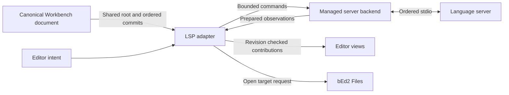

# LSP integration for Bedtime 2

Status: investigation and proposed implementation sequence, 2026-10-22.
The runtime and APIs below are proposals. Current v2 installs no LSP services.

Build an optional `bedtime-lsp2` plugin around Workbench's canonical documents
and managed work. Use bed1's protocol behavior and regression scenarios as the
starting point, with persistent text snapshots and background protocol work.
Keep file policy, server configuration and navigation destinations in bEd2.
The first useful slice is local stdio synchronization, diagnostics and Go to
Definition with one configured server, followed by hover and completion.

The strongest performance opportunity is already visible in bed1: incremental
wire synchronization still accompanies a complete source join and retry-cache
copy after edits. V2 can replace those copies with shared immutable roots.
Actual latency and memory improvements require a prototype and measurements;
the existing test results below establish behavior, not a speed comparison.

## Evidence from bed1

The relevant implementation is spread across three existing boundaries:

| Boundary | Useful starting points |
| --- | --- |
| Protocol and server ownership | [`bedtime-lsp`](../bedtime/crates/bedtime-lsp/src/lib.rs), especially `message_handler.rs`, `lsp_document_sync.rs` and `workspace_lsp.rs` |
| Canonical documents and edit admission | [`document_runtime.rs`](../bedtime/crates/bedtime-documents/src/document_runtime.rs), [`session.rs`](../bedtime/crates/bedtime-documents/src/session.rs), [`workspace_edits.rs`](../bedtime/crates/bedtime-documents/src/workspace_edits.rs) |
| Feature interaction and presentation | [`completion.rs`](../bedtime/crates/bedtime-plugin-editor/src/lsp/completion.rs), [`editor_actions.rs`](../bedtime/crates/bedtime-plugin-editor/src/lsp/editor_actions.rs), navigation and hover modules beside them |

Preserve these established behaviors:

- One server instance per server identity and resolved project root, shared
  between documents. Workspace ownership and server generations are explicit.
- Ordered incremental changes, lazy full-text providers, latest pending opens
  during initialization, and cancellation of documents closed before startup.
- Request deadlines, cancellation and origin checks covering session, server,
  document, version, view and ticket. A cancellation request alone cannot make a
  late response safe to consume.
- Bounded framing, input/output queues, stderr retention and pending requests.
  The existing transport already parses incoming JSON on its reader worker.
- UTF-16 boundary validation, retained diagnostic code/data, server-request
  replies after edit admission, and independent diagnostic providers.
- Root/executable discovery, literal argument/environment handling and useful
  startup failures. Adapt these behaviors to current application policy.

### Costs and constraints worth changing

| Finding in current source | Consequence for v2 |
| --- | --- |
| `DocumentSession::with_document_mut` calls `update_lsp_snapshot` after changes; that method calls `state.join()`, and `WorkspaceLsp::update_document_snapshot` copies the bytes again. | Retain cheap `TextBuffer` roots for initialization, retry and resync. Incremental messages alone do not remove this O(document bytes) work. |
| `DocumentSession::snapshot` joins all source bytes; completion requests use it and retain source snapshots for result parsing. | Capture a revision and persistent root; compute prefixes, ranges and result transformations on a worker. |
| `RpcSession::queue` calls `encode_packet` on its caller; packet conversion clones JSON parameters before encoding and copying into a frame. | Serialize outgoing messages on the protocol worker, directly from typed payloads where practical. |
| JSON callbacks, diagnostic decoding and completion parsing execute when the host polls. The 256-event poll cap does not bound the work within one event or batch. | Decode and index large results in the backend; budget main-world acceptance by time and count. |
| `LspDiagnostics::for_document` clones a report, and `for_line` calls it before filtering. | Publish shared immutable reports with line/range indexes. Avoid rebuilding or cloning a complete report for visible rows. |
| `SharedLspClient` is `Rc<RefCell<LspClient>>`, with callback-based mutation on the polling thread. | Use owned commands/results across the worker boundary; keep protocol state out of ECS/UI callbacks. |
| Shutdown waits synchronously for handshake, process termination and worker completion. Remaining pipe readers can be detached. | Run cleanup inside managed work; report completion only after process and I/O cleanup. |

These are source-level costs and ownership constraints. Their contribution to
whole-app frame time has not been profiled.

Some v1 tests intentionally preserve upstream compatibility quirks:
`save:false` still enables save notifications, missing sync capabilities default
to incremental, `openClose:false` is ignored, and fractional sync enums are
truncated. V2 should implement the specified capability semantics and validate
known fields strictly, while tolerating unknown extension fields. Missing
`textDocumentSync` means None; `save:false` does not request save notifications.
See the official [initialization contract](https://raw.githubusercontent.com/microsoft/language-server-protocol/gh-pages/_specifications/lsp/3.17/general/initialize.md)
and [save contract](https://raw.githubusercontent.com/microsoft/language-server-protocol/gh-pages/_specifications/lsp/3.17/textDocument/didSave.md).

## Existing v2 capabilities and integration gaps

[Editor2](../bedtime2/crates/bedtime-editor2/README.md) already provides shared,
indexed UTF-8 roots, revision-bound navigation and controlled edit admission.
[Workbench2](../bedtime2/crates/bedtime-workbench2/README.md) owns canonical
revisions/history, drafts, source reconciliation and cancellable workspace work.
The [Tree-sitter adapter](../bedtime2/crates/bedtime-editor2/src/workbench/analysis.rs)
demonstrates document-level analysis shared by hidden and visible viewers.

Use `document_changes_since::<TextBuffer>` directly: its 128-commit journal
retains ordered `BufferEdit`s, including replacement roots, transactions,
undo and redo. `TextSession::changes_since` deliberately reduces these edits to
position deltas, which cannot reconstruct inserted text. Whole-model
replacement and a journal gap are explicit invalidations.

Four gaps need deliberate changes:

1. **Document identity.** bEd2's `FileSource` is private, mutable application
   state; Workbench `source_key` deliberately stays unset. The application must
   project a validated URI and an attachment generation onto the canonical
   document, updating them on rename, deletion and rebinding. Do not infer a
   path from a title, panel, or save destination.
2. **Language identity.** `CodeLanguage` currently belongs to optional
   Tree-sitter integration. Grammar names, LSP language IDs and server IDs are
   different concepts: a TSX document can use the TypeScript grammar/server
   family but must send `typescriptreact`. An LSP-only host must work without
   Tree-sitter. bEd2 maps its language choice to each backend explicitly.
3. **Editor contributions.** Navigation exists, but diagnostics, hover hit
   observations, popup anchors and completion interaction do not. Add narrow
   data/interaction APIs to Editor2 as the corresponding feature lands. Keep
   their payloads independent of JSON-RPC and LSP types.
4. **Saved snapshots and multi-document edits.** `DocumentSaveFinished` exposes
   the captured revision but not its text; saves can finish after more edits.
   Preserve the immutable save capture for `didSave(includeText)` through a
   concrete save observation path. Workbench transactions currently cover one
   document; they do not establish atomic workspace edits across documents.

## Proposed crate and ownership boundaries

Start with one `bedtime-lsp2` crate, with a headless backend and optional
Workbench and editor integration. Keep the editor feature dependent on
Workbench for the initial implementation; a standalone editor adapter can wait
for an actual consumer. Default Editor2, Workbench2 and Tree-sitter builds stay
independent of LSP. A separate bEd-specific plugin crate is unnecessary initially;
`bed2/src/code.rs` can install the plugin and the application bridge.

| State or effect | Owner |
| --- | --- |
| Canonical text, revisions, history, drafts and save admission | Workbench documents |
| File URI, language selection, effective server definitions, project-root policy, settings and target opening | bEd2 |
| Document attachment, accepted journal cursor and published observations | LSP Workbench adapter |
| Child process, protocol lifecycle, capabilities, request table, deadlines, wire versions and coordinate conversion | Managed server backend |
| Selection, hover/completion intent and popup presentation | Editor view and its feature controller |

Represent each server with a workspace-owned entity and one managed task whose
local owner is that entity. Its identity is `(workspace, server id, resolved
root)`, with a fresh generation for every launch. Documents hold references to
their binding, rather than each holding a process. Begin with one selected server
per document; reports still carry server identity to avoid conflating providers.
Keep separate workspaces' processes separate even when their folders overlap.

The backend is the single writer of protocol state. Its ECS handle supplies
bounded command admission and immutable observations, with no editor references
or arbitrary callbacks. The main-world adapter alone admits document edits and
navigation effects after checking the observation's origin.

Advertise only implemented client capabilities. The initial handshake must
already answer the configuration/workspace requests it advertises, handle
enabled progress and message notifications, and return MethodNotFound for
unsupported requests. Keep dynamic registration and `workspace.applyEdit`
disabled until their complete admission paths exist.



Discover roots and executables off-thread, with the explicit workspace directory
as the search ceiling. The default home workspace must not trigger a recursive
home scan. For files outside a folder workspace, make the standalone root an
explicit application choice. Command/environment/settings changes restart the
affected instance with a new generation. Persist configuration in bEd2's existing
centralized `.bed` settings; do not reintroduce project metadata or v1 JSON import.

### Admission and shutdown

Create attachments for eligible file-backed documents. Admit a server lazily
when a document has an editor viewer; hidden tabs and inactive layouts count.
After admission, retain synchronization while there are viewers or unsaved
canonical changes. A clean document without viewers can detach, even though
Workbench retains its model. This avoids keeping every historically opened file
live inside the server. Do not detach dirty documents merely because a tab closes.
The protocol's [close notification](https://raw.githubusercontent.com/microsoft/language-server-protocol/gh-pages/_specifications/lsp/3.17/textDocument/didClose.md)
returns content ownership to the source.

Startup proceeds through discovery, launch, initialization and Ready; failures
retain an actionable status and support explicit retry. While initialization is
pending, retain the latest desired root, rather than a backlog of whole strings.
Retirement removes that desired open. Restart invalidates requests and reports,
then opens the latest roots after the new handshake.

All I/O, including startup and shutdown, belongs in `WorkspaceWork::spawn_task`.
`WorkspaceProcess` is unsuitable for protocol transport: it retains only the
newest 256 KiB of output and accepts individual writes of at most 8 KiB. Losing
stdout bytes corrupts framing. Custom task-owned processes also need their own
process-group and reap logic; Workbench's generic process guarantees do not
automatically apply to children created inside a task.

The backend must respond to cancellation while idle or while stdin is blocked.
On shutdown it stops ordinary admission, attempts the
[shutdown/exit sequence](https://raw.githubusercontent.com/microsoft/language-server-protocol/gh-pages/_includes/messages/3.17/shutdown.md),
then closes pipes, terminates the process group if needed and reaps the child.
Use cancellation-aware I/O so inherited descendant pipes cannot require detached
readers. bEd2's existing quit gate waits for managed completion without waiting
on the drawing thread.

## Synchronization and result correctness

Keep canonical `u64` revisions separate from LSP integer versions. The backend
assigns increasing wire versions and retains a bounded mapping to exact roots
and attachment identities. Preserve monotonicity for a URI within a server
generation, including detach/reopen; never cast revisions or silently wrap.
Version exhaustion requires a fresh server generation. Undo and redo are new
versions, as required by the [version contract](https://raw.githubusercontent.com/microsoft/language-server-protocol/gh-pages/_specifications/lsp/3.17/types/versionedTextDocumentIdentifier.md).

For incremental synchronization, the worker starts from its retained base root,
converts each `BufferEdit` range against that pre-change state, then applies the
edit locally before processing the next. Worker roots are derived protocol
snapshots, never a second editable document. Send changes in that order, with
the final wire version. A journal gap or model replacement sends a complete
replacement when change synchronization permits it; do not fabricate missing
deltas or diff a whole document on the main thread. This follows the
[ordered change contract](https://raw.githubusercontent.com/microsoft/language-server-protocol/gh-pages/_specifications/lsp/3.17/textDocument/didChange.md).

Use a bounded FIFO command stream. Advance the adapter's journal cursor only
after admission succeeds. When full, retain the newest desired root and retry
from the last admitted revision; a subsequent journal gap takes the full
replacement path. Batch commits between adapter updates, and flush the requested
revision before its hover/completion/navigation request on the same ordered
stream. Coalesce unsent desired snapshots; never discard admitted deltas or move
updates across a request/save/close barrier. A successful pipe write is an
ordering fact, not a server acknowledgement of analysis completion.

Prefer `utf-8` in `general.positionEncodings`, with mandatory `utf-16` fallback
and UTF-16 when the server omits its choice. Reject an unsupported selection.
Conversion operates on the captured root; display cells, graphemes and editor
`column()` are not protocol columns. Start with indexed line lookup and worker
scans within the line; measure pathological long Unicode lines before adding
UTF-16 subtree summaries to the rope. Handle surrogate boundaries, tabs, emoji,
combining text and line endings explicitly. See [position encoding](https://raw.githubusercontent.com/microsoft/language-server-protocol/gh-pages/_specifications/lsp/3.17/types/position.md).

Each interactive result carries server generation, document entity, attachment
generation, canonical revision, panel and request ticket. Reject stale results
at the single main-world acceptance boundary. Edits also check drafts and target
revisions. Navigation opens through Files, converts against the target snapshot
and uses `navigate_editor`; source freshness alone cannot prove freshness of a
cross-file destination whose server version is unknown.

Store diagnostics as immutable, indexed reports by server and URI. Versioned
reports refer to the mapped source version; discard reports whose identity or
version is no longer known. Unversioned pushes cannot establish exact revision
freshness. Treat them as best-effort observations and mark retained reports
stale after edits; do not relabel their ranges as current or silently use them
as an edit precondition. An empty report replaces the previous report. Preserve
opaque code/data for later code actions. Start with push diagnostics, then add
document pulls with result IDs and refresh handling. Defer workspace pulls until
their priority and aggregation semantics are implemented. See the official
[push](https://raw.githubusercontent.com/microsoft/language-server-protocol/gh-pages/_specifications/lsp/3.17/language/publishDiagnostics.md)
and [pull](https://raw.githubusercontent.com/microsoft/language-server-protocol/gh-pages/_specifications/lsp/3.17/language/pullDiagnostics.md)
contracts.

Save notification admission requires a successful, identity-matching save
receipt and the root actually written. If newer edits exist, they stay
synchronized as newer content; `includeText` still describes the saved capture.
Failed/CAS-rejected saves emit no `didSave`. Keep saved roots until notification
admission completes, within the same bounded ownership model.

Formatting is a good first mutation feature: convert the complete edit set
against one captured root, validate overlaps and boundaries, prepare the result
off-thread and commit once at the expected revision. General `workspace/applyEdit`
comes later. Add a Workbench-owned batch admission API that preflights every
target and stages all models before any mutation, with explicit undo semantics.
Reject unsupported resource operations as a whole and reply only after the
admission outcome. Do not advertise transactional/undo guarantees that only
hold for one document. The [applyEdit response](https://raw.githubusercontent.com/microsoft/language-server-protocol/gh-pages/_specifications/lsp/3.17/workspace/applyEdit.md)
must describe what actually happened.

## Dependencies and performance choices

Use `serde`/`serde_json` and evaluate `lsp-types` for wire schemas. Its documented
[client encoding](https://docs.rs/lsp-types/0.97.0/lsp_types/struct.GeneralClientCapabilities.html)
and [server capability](https://docs.rs/lsp-types/0.97.0/lsp_types/struct.ServerCapabilities.html)
types cover the negotiation needed here. Select and pin a compatible release
during implementation; types still need semantic validation and owned execution.
Keep opaque server payloads at the boundary. Do not depend on `bedtime-lsp`
wholesale: it brings v1 editing/remote contracts and the polling-thread ownership
model. Copy/adapt small useful pieces with their attribution and tests if that
is simpler than changing v1's public contracts.

`lsp-server` is useful reference code for messages and transport, but its
[stdio implementation](https://raw.githubusercontent.com/rust-lang/rust-analyzer/master/lib/lsp-server/src/stdio.rs)
uses the hosting process's stdin/stdout and dedicated threads. It does not supply
the required child-process/document lifecycle. A server framework is unnecessary
for this client.

Prototype one cancellation-aware backend loop per server on the supported Unix
platforms, with nonblocking pipes and a command wakeup. Bound work per readiness
cycle so stdout floods cannot starve commands or cancellation. Compare complexity
and idle/loaded measurements with a shared async I/O runtime before committing
to it. Workbench's current `Cancellation` wakes a condition variable, not a pipe
selector: the spike must choose between a bounded selector timeout and a concrete
cancellation wakeup integration, and measure the idle wakeups that choice costs.
Tokio already exists in the workspace, but adding it to this v2 feature
must justify the runtime and lifecycle; a custom reactor must justify its own
partial-write/framing/cancellation complexity. The expected first gain is reduced
main-thread copying and computation, rather than a particular thread count.

Queue limits must cover byte retention as well as message count, pending
requests, outstanding roots and prepared results. Reserve admission for
responses/cancellation/shutdown; coalesce replaceable progress/diagnostic
observations. Protocol requests and partial diagnostic chunks are ordered work,
not replaceable UI observations. When a bound is exhausted, refuse optional work
or fail/restart the affected session explicitly; never silently lose sync bytes.
Retire large reports and buffers on the backend where practical so their final
drop does not become a main-thread stall.

Use a separate, explicit LSP source-size limit. An initial 8 MiB policy is a
reasonable experiment, independent of Tree-sitter's limit and the editor's
256 MiB file-loading allowance. Enforce encoded frame size too: JSON escaping
can make an eligible source exceed the frame budget. Refusal leaves plain text
editing available and exposes a Limited status. Do not launch LSP automatically
for the million-line editor fixture.

## Implementation sequence and verification

1. **Backend and document bridge.** One configured local server, typed
   capabilities, UTF-8/UTF-16, shared-root initialization/retry, incremental/full
   sync, save receipts, close/restart and managed shutdown. Use a deterministic
   fake server before connecting a real one. Include blocked stdin, output
   floods, idle cancellation, malformed frames and inherited pipes.
2. **First visible features.** Shared push diagnostics and explicit Go to
   Definition. Add Editor2's minimal diagnostic contribution, Files target
   opening, useful server status and restart. Exercise two views, hidden tabs,
   inactive workspaces, preview replacement and rename/deletion.
3. **Interactive editing.** Hover, then completion with trigger characters,
   cancellation, bounded filtering and lazy item resolution. Add document pull
   diagnostics. Completion needs editor input arbitration, replacement ranges,
   additional edits and explicit snippet support; advertise only implemented
   capabilities.
4. **Mutation and broader compatibility.** Single-document formatting, then
   rename/code actions and workspace edits through shared batch admission.
   Implement watched-file registration/forwarding and required server requests
   as compatibility demands, with truthful capability negotiation. Remote
   transport, installers, multiple servers per document, semantic tokens,
   inlay hints and workspace diagnostic pulls remain later work.

Before calling the first slice faster, compare the same release builds, fixture
contents, edit sequence, hardware and server settings in bed1 and the prototype.
Use a deterministic fake server to isolate client work, then rust-analyzer and
at least one other server for integration. Keep cold start/indexing separate
from warmed interaction and server analysis latency.

| Scenario | Measurements and required behavior |
| --- | --- |
| Idle workspace and several server roots | CPU, wakeups, thread/process count and retained memory |
| Typing in 100 KiB, 1 MiB and near-limit documents | Main-thread LSP time and bytes copied per edit; p50/p95/p99 input-to-paint and result latency; no whole-source client copy on ordinary incremental edits |
| Long Unicode line, multiline paste, undo/redo and replacement | Conversion CPU, wire bytes and server mirror equality after every request barrier |
| Two or more views of one document | One synchronization stream and shared diagnostics, with independent view tickets |
| Diagnostic/completion flood and blocked writer | Queue bytes, retained roots, high-water marks, overload outcome and bounded acceptance/frame work |
| Last viewer closes, workspace switches/closes, quit and restart | Correct dirty-document ownership, no UI-thread shutdown waits, actual child reap and no unmanaged readers |
| Large file above the LSP limit | No server/source materialization, normal viewport-only editing |

Reuse bed1's [transport scenarios](../bedtime/tests/integration/lsp/lsp_transport.rs),
[mock server](../bedtime/crates/bedtime-test-fixtures/src/lsp.rs), Unicode/edit
validation cases and [real-server tests](../bedtime/tests/integration/lsp/real_servers.rs).
Keep regression fixtures independent of the v1 desktop frontend. In addition to
mirror equality, cover journal eviction, rejected transactions, stale replies,
IME drafts, protocol capability defaults, asynchronous saves of older revisions
and all-or-nothing edit rejection. Record performance budgets after the first
baseline rather than asserting an unmeasured speedup.

On 2026-10-22, this investigation ran:

```sh
cargo test --offline --locked -p bedtime-lsp --lib
# 77 passed.
cargo test --offline --locked -p bedtime-workbench2 --no-default-features committed_change
# 2 passed: ordered transactions/history/replacements and independent readers/gaps.
```

No v2 LSP prototype, real-server compatibility run or comparative performance
measurement is established by those checks. The next concrete step is phase 1,
with source-copy counters and a fake-server mirror from the beginning.
