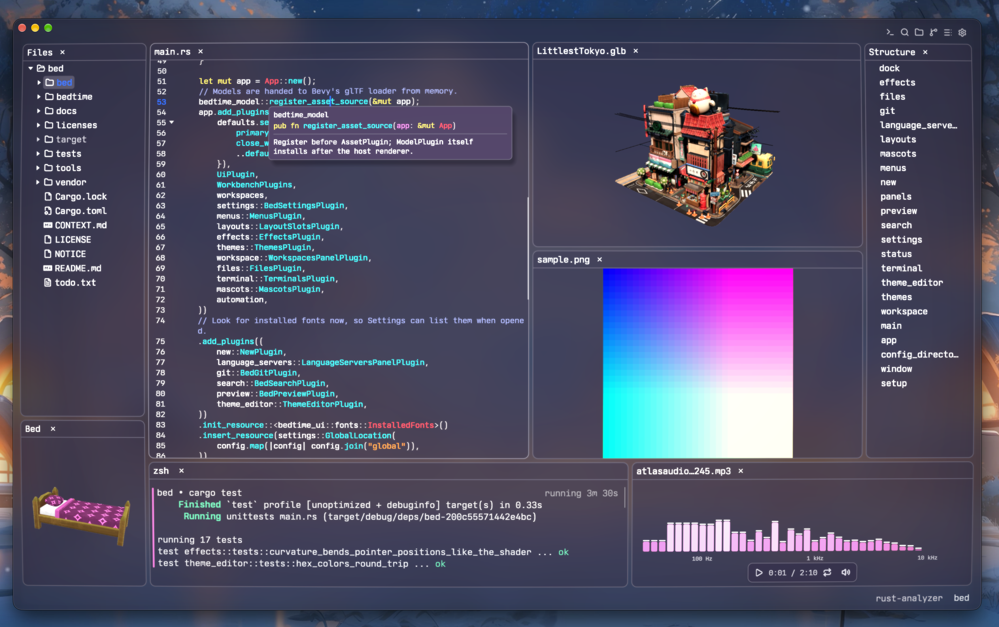
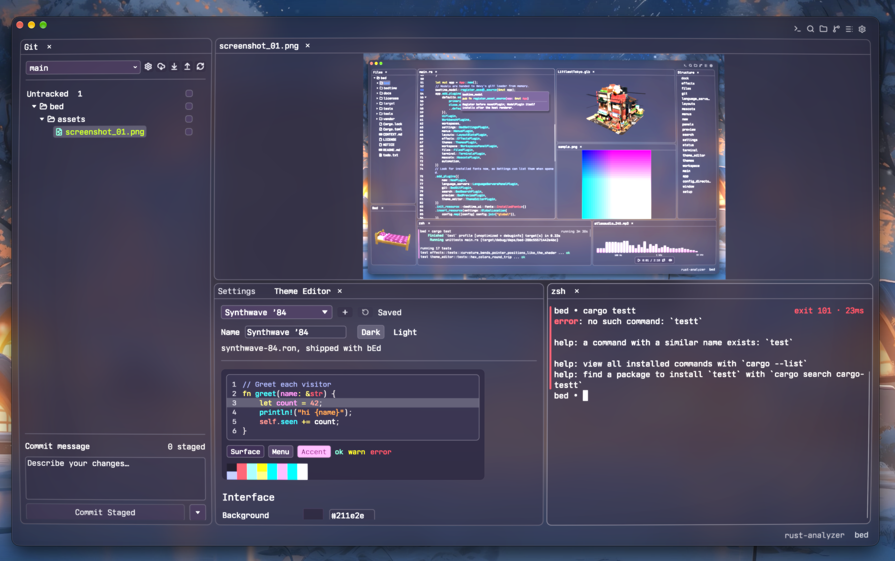
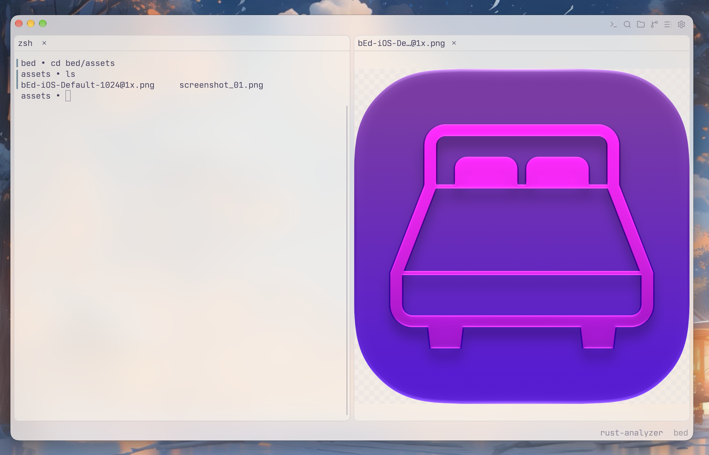

# bEd (Ben's EDitor)

bEd is a next-generation IDE built with [Bevy](https://bevy.org/). it brings code editing, terminals, git, and media viewers together in a customizable workbench.

**work in progress:** currently supported on macOS with Apple silicon. Linux support is planned.



## features

- **code editing** — tree-sitter syntax highlighting, folding, a structure outline, find and replace, and undo/redo.
- **language intelligence** — language server support for completions, diagnostics, hover documentation, go to definition, references, rename, code actions, and formatting. available capabilities depend on the server.
- **project navigation** — a file tree with preview tabs, file and folder management, drag-and-drop opening, and an “open with” viewer chooser.
- **project-wide search** — search and replace across files, with regular expressions, case and whole-word matching, and include/exclude globs.
- **git integration** — browse changes and diffs, stage or unstage individual hunks, commit and amend, switch branches, fetch, pull, push, and resolve conflicts.
- **integrated terminals** — local shell sessions with command navigation, completion notifications, and clickable file paths and links.
- **previews and data views** — Markdown previews, JSON/TOML tree views, editable CSV/TSV tables, and a read-only hex viewer.
- **media viewers** — images (including SVG and animated formats), audio with waveform and spectrum views, video playback on macOS, glTF/GLB/STL models, and fonts.
- **a workbench that remembers** — tabs and split panels, saved layout slots, recent workspaces, and persisted workspace state.
- **make it yours** — bundled color themes, configurable fonts and keybindings, global and workspace settings, visual effects, and a couple of 3D mascots.





## installation

### prerequisites

- a Mac with Apple silicon.
- Xcode command line tools, which provide the native build tools and git:

  ```sh
  xcode-select --install
  ```

- a current stable [Rust toolchain](https://www.rust-lang.org/tools/install), including Cargo. if you already use rustup, update it with `rustup update stable`.
- Python 3 for packaging the macOS app. check that `python3 --version` works.

language servers are separate tools: install the ones you need and make their executables available on `PATH`, or configure their paths in the **Language Servers** panel. git features use the installed `git` executable.

### build and install the macOS app

clone the repository and run the packaging script:

```sh
git clone https://github.com/b3nten/bEd.git
cd bEd
bash tools/package-macos.sh --install
open /Applications/bEd.app
```

the script builds the release binary, bundles assets and license notices, and installs `bEd.app` in `/Applications`. it also produces the app and a versioned ZIP in `target/dist/`.

to install for your user only, choose a different destination:

```sh
BED_INSTALL_DIR="$HOME/Applications" bash tools/package-macos.sh --install
open "$HOME/Applications/bEd.app"
```

to create the app and ZIP without installing, run `bash tools/package-macos.sh`. the bundle is ad-hoc signed locally; the script does not perform Apple notarization.

### run from source

from the repository root:

```sh
# launch with the default workspace
cargo run --locked --release -p bed

# open a project folder
cargo run --locked --release -p bed -- /path/to/project
```

for a development build, omit `--release`. to build without launching:

```sh
cargo build --locked --release -p bed
./target/release/bed /path/to/project
```

## getting started

- open a folder with **Cmd+O**, or pass its path when launching from the command line.
- use the titlebar buttons to open Files, Search, Git, Terminal, Structure, or Settings panels.
- search the project with **Cmd+Shift+F**.
- open a preview beside a supported text document with **Cmd+Shift+M**.
- customize themes, fonts, and keybindings in **Settings**, and configure code intelligence in **Language Servers**.

settings and workspace data default to `~/.config/bed`. set `BED_CONFIG_DIR` to override the location; otherwise, `XDG_CONFIG_HOME` is respected when set.

## development

```sh
cargo check --locked -p bed
cargo test --locked --workspace --all-features
```

see [the architecture overview](docs/architecture.md) for the application and Bedtime crate layout. scripted UI automation is available through [`tools/bed.py`](tools/bed.py).

## license

bEd is licensed under [GPL-3.0-only](LICENSE). see [NOTICE](NOTICE) for third-party attribution; packaged apps include dependency and asset notices.
