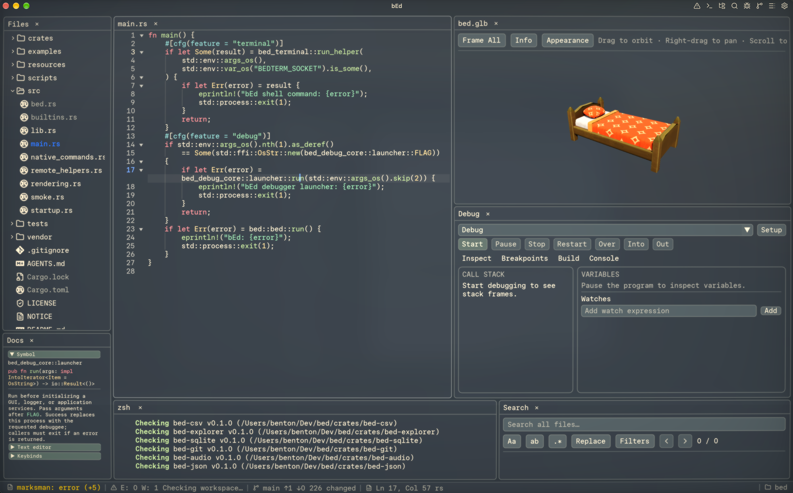

# bEd

A desktop application platform and IDE with a tiled workspace.

**macOS and Linux only. Linux is currently untested. bEd is very experimental.**



## Features

- Code editing with syntax highlighting, folding, completion, diagnostics, and language server support.
- File explorer, project search, Git diffs, debugger, and integrated terminals.
- Draggable panels, split views, and nine saved workspace layouts.
- Viewers for Markdown, images, 3D models, fonts, audio, CSV, JSON, and SQLite, plus an HTTP client.
- SSH workspaces, themes, and configurable keyboard shortcuts.

## Build and run

You’ll need Rust and Cargo (stable), Git, and a C/C++ compiler. On macOS, install the Xcode Command Line Tools:

```sh
xcode-select --install
```

On Debian/Ubuntu, install the native dependencies:

```sh
sudo apt-get install build-essential pkg-config libxkbcommon-dev libwayland-dev libx11-dev libxcursor-dev libxrandr-dev libxi-dev libasound2-dev libvulkan1 mesa-vulkan-drivers
```

Clone and build:

```sh
git clone https://github.com/b3nten/bEd.git
cd bEd
cargo build --release -p bed
```

Run bEd, optionally passing a project directory or files:

```sh
./target/release/bed
./target/release/bed /path/to/project
./target/release/bed src/main.rs
```

For development:

```sh
cargo run -p bed
```

## Build another desktop application

[`BedCorePlugin`](crates/bed-core/README.md) installs the window, renderer,
Dear ImGui, theme, fonts, icons, panel/layout system and shared document editing.
Add feature plugins to a fresh Bevy `App`; the host owns startup, configuration
and persistence. bEd adds its workspace selection, MRU, SSH orchestration and
application integration on top of that foundation.

The examples show the supported composition boundaries:

- [`bed-example-terminal`](examples/terminal/README.md): core and ordinary terminal panels.
- [`bed-example-editor`](examples/editor/README.md): text/hex editors with shared
  documents and undo/redo, without workspace or language-server services.
- [`bed-example-model`](examples/model/README.md): a typed model shared by two panels,
  using the same document/history commands.
- [`bed-example-layouts`](examples/layouts/README.md): optional numbered layouts from
  [`bed-plugin-layouts`](crates/bed-plugin-layouts/README.md), with application-owned disk persistence.
- [Gameplay editor and runtime](examples/gameplay/README.md): one Bevy game runs in
  an editor viewport, or directly in a standalone runtime without bEd foundations.

Plugins register their own namespaced artwork and filename contracts. Hosts can
override directories per plugin; embedded defaults make the examples independent
of bEd's resource directory. See the [icon contract](crates/bed-ui/README.md).

Install language servers separately for the languages you use. Open **Settings → Keybindings** to see or change shortcuts.

## Crates and vocabulary

Optional features use `bed-plugin-*`, such as `bed-plugin-editor`,
`bed-plugin-terminal` and `bed-plugin-layouts`. Foundations and support libraries
keep domain names: `bed-core`, `bed-desktop`, `bed-documents`, `bed-terminal` and
`bed-git`. The latter two supply backends; their `bed-plugin-*` counterparts
supply panels and commands. Example applications use `bed-example-*`.

| Term | Responsibility |
| --- | --- |
| Editor | Code editor plugin and its text/hex widgets in `bed-editor-widgets` |
| Documents | Content, revisions, views, saving and undo/redo |
| Workbench | Panels, commands, focus and layout |
| Host | Application supplying services and resolving registered requests |
| File context | Selected directory, provider identity and connection availability |
| Workspace | Optional saved arrangement and plugin state associated with a location |
| App | bEd startup, native windows, configuration and persistence policy |

[`bed-api`](crates/bed-api/README.md) holds shared contracts in `workbench`,
`documents`, `features`, `files`, `storage`, `settings`, `presentation`, `status`
and `gpu` modules.
Use `bed_core::api` when building on core. The API's default build supports a
workbench without document services; its `documents` feature adds document
contracts. `gpu` and `language-services` are separate opt-ins.

[`bed-app`](crates/bed-app/README.md), `bed-app-config` and `bed-app-shell` own
bEd's application policy. The Workspaces and Settings panels are named
`bed-plugin-workspaces` and `bed-plugin-settings` because they are Bevy plugins,
and the workspace plugin accepts an application-supplied repository. Documents,
Search, Explorer and Git use the live file context without requiring a saved
workspace. New directories stay temporary until explicitly saved; global
preferences remain persistent.

[`bed-storage`](crates/bed-storage/README.md) holds app-neutral plugin snapshots.
The application chooses their persistence scope and storage implementation.

The [`bed-remote-agent`](crates/bed-remote-agent/README.md) executable serves
remote filesystem, Git, language-server and process requests without a window.
Desktop packages include native Linux agents for SSH deployment.

## License

[GPL-3.0-only](LICENSE). Third-party attribution and licenses are in [NOTICE](NOTICE).
